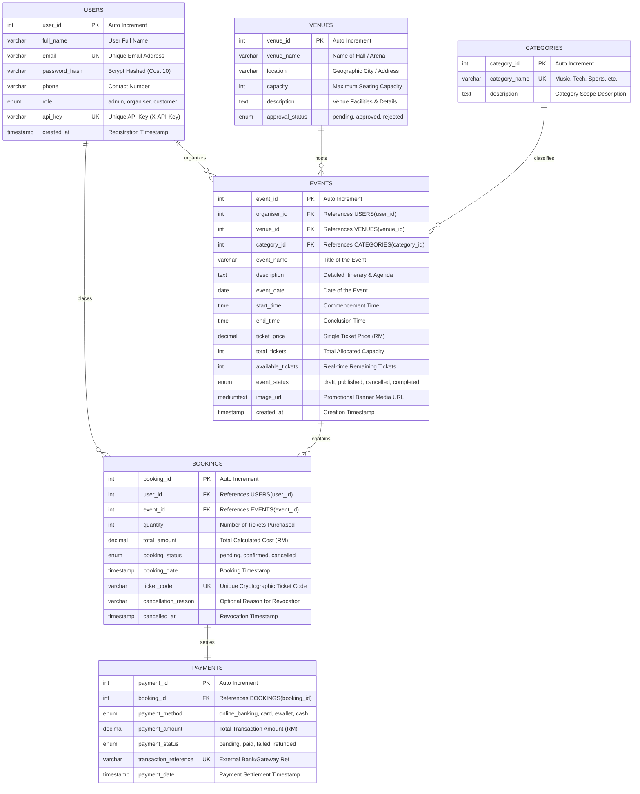

# Entity Relationship Diagram (ERD) & Database Specification
**Course**: SWC3633 / SWC4443 Web API Development  
**Institution**: Universiti Poly-Tech Malaysia (UPTM)  
**System**: Event Ticketing and Venue Booking RESTful Web API  
**Database**: MySQL / MariaDB (`event_ticketing_db`)  

---

## 1. Visual Entity Relationship Diagram (Mermaid)

---

## 2. Relational Cardinalities & Business Rules

| Relationship | Cardinality | Business Description & Integrity Rule |
| :--- | :--- | :--- |
| **USERS -> EVENTS** | `1 : N` (One-to-Many) | An organiser can create and manage zero or more events. An event is owned by exactly one organiser (`organiser_id`). If an organiser account is purged, child events cascade delete. |
| **VENUES -> EVENTS** | `1 : N` (One-to-Many) | A venue can host multiple events over different dates. An event must be hosted at exactly one approved venue. `ON DELETE RESTRICT` protects venues with scheduled events. |
| **CATEGORIES -> EVENTS** | `1 : N` (One-to-Many) | A category groups multiple events. Each event belongs to one primary genre/category. `ON DELETE RESTRICT` ensures catalog consistency. |
| **EVENTS -> BOOKINGS** | `1 : N` (One-to-Many) | An event can receive many customer bookings. Each booking pertains to a single event. Buying a ticket triggers an atomic decrement of `available_tickets`. |
| **USERS -> BOOKINGS** | `1 : N` (One-to-Many) | A customer can make multiple bookings. Each booking belongs strictly to one customer. Customers can only view and manage their own bookings (RBAC). |
| **BOOKINGS -> PAYMENTS** | `1 : 1` (One-to-One) | Each booking record generates a corresponding payment transaction. Successful payment confirmation transitions the booking from `pending` to `confirmed`. |

---

## 3. Data Integrity & Constraints

1. **Entity Integrity (Primary Keys)**:
   - All tables enforce integer auto-increment primary keys (`user_id`, `venue_id`, `category_id`, `event_id`, `booking_id`, `payment_id`).
2. **Referential Integrity (Foreign Keys)**:
   - Cascading deletes are enforced on direct user associations (`organiser_id`, `user_id` in bookings).
   - Restrictive constraints prevent accidental deletion of venues or categories that have active scheduled events.
3. **Unique Keys (Uniqueness Enforcements)**:
   - `users.email`: Guarantees unique login credentials.
   - `users.api_key`: Guarantees secure deterministic API key authentication.
   - `categories.category_name`: Prevents duplicate genres.
   - `bookings.ticket_code`: Cryptographically unique QR pass identifier (`TKT-UUID-CODE`).
   - `payments.transaction_reference`: Prevents duplicate transaction settlements.
4. **Domain Integrity**:
   - ENUM types constrain valid states for roles (`admin`, `organiser`, `customer`), venue approval (`pending`, `approved`, `rejected`), event status (`draft`, `published`, `cancelled`, `completed`), booking status (`pending`, `confirmed`, `cancelled`), and payment status (`pending`, `paid`, `failed`, `refunded`).
   - Monetary values (`ticket_price`, `total_amount`, `payment_amount`) are explicitly stored as `DECIMAL(10,2)` to prevent floating-point calculation inaccuracies.
